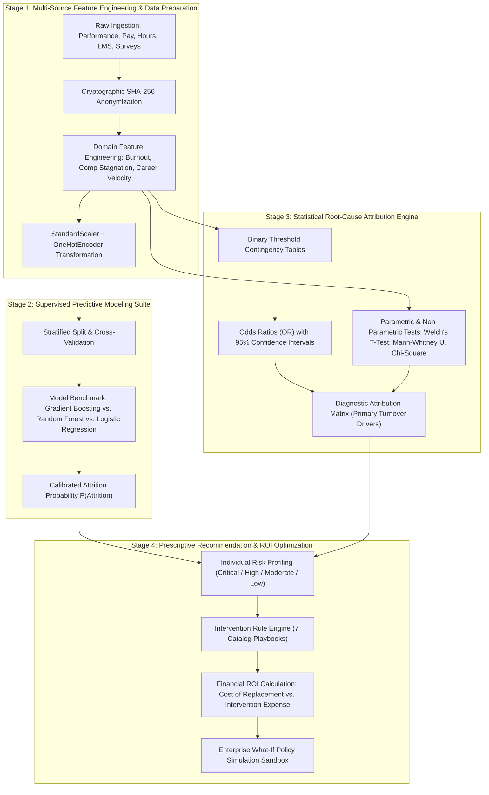
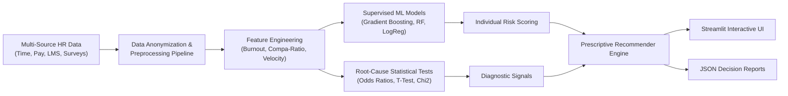

<div align="center">

# 👥 Employee Attrition Root-Cause Intelligence
### AI-Powered Multi-Source Workforce Analytics, Causal Attribution & Prescriptive Retention Platform

[](https://www.python.org/)
[](LICENSE)
[](https://streamlit.io/)
[](https://scikit-learn.org/)
[](https://www.python.org/dev/peps/pep-0008/)

*A comprehensive enterprise AI system integrating employee performance, workload, compensation, absenteeism, overtime, pulse surveys, and training data to uncover the root causes of turnover and deliver actionable, evidence-based retention playbooks.*

---

</div>

## 🎯 Problem Statement

Employee turnover poses an immense operational and financial challenge to modern organizations. According to industry research, replacing an employee costs **50% to 150% of their annual salary** when factoring in direct recruitment expenses, onboarding investments, disrupted project timelines, and loss of institutional knowledge. 

Despite substantial investments in Human Resources Information Systems (HRIS), organizations consistently struggle with:
- **Data Fragmentation:** Critical workforce signals—ranging from timesheet overtime and compensation benchmarks to quarterly survey sentiment and learning management logs—remain isolated in disconnected operational silos.
- **Lagging, Reactive Analytics:** Standard HR reporting is retrospective, examining exit interviews and quarterly attrition rates only *after* valuable talent has already departed.
- **The "Black-Box" Insight Gap:** Conventional predictive ML models may predict *which* employees are likely to leave, but fail to deliver interpretable, statistically sound causal explanations for *why* they are leaving.
- **Absence of Actionable Interventions:** HR business partners and team leads lack data-driven, cost-weighted prescriptive recommendations to intervene proactively before disengagement crystallizes into a resignation.

**Employee Attrition Root-Cause Intelligence** addresses this fundamental problem by fusing multi-source workforce signals, applying statistical hypothesis testing and Odds Ratio causal attribution, and generating individualized, ROI-evaluated retention playbooks alongside enterprise-wide what-if policy simulations.

---

## 📌 Table of Contents
- [Problem Statement](#-problem-statement)
- [Project Overview & Purpose](#-project-overview--purpose)
- [Core Features](#-core-features)
- [Repository Structure](#-repository-structure)
- [Algorithm Overview](#-algorithm-overview)
- [Architecture & Workflow](#-architecture--workflow)
- [Data Requirements & Schema](#-data-requirements--schema)
- [Installation & Quickstart](#-installation--quickstart)
- [Usage Guide](#-usage-guide)
- [User Interface Overview](#-user-interface-overview)
- [Documentation Suite](#-documentation-suite)
- [Contributing](#-contributing)
- [License](#-license)

---

## 🚀 Project Overview & Purpose

Workforce attrition is one of the most significant and preventable cost centers in modern organizations. Replacing an employee typically costs **50% to 150% of their annual salary** in lost productivity, recruiting overhead, and ramp-up time. Traditional HR analytics tools only report backward-looking turnover rates or apply black-box ML models that alert managers *that* someone might quit without explaining *why* or *what concrete actions to take*.

**Employee Attrition Root-Cause Intelligence** solves this by bridging the gap between predictive machine learning and causal root-cause diagnostics:
1. **Multi-Source Data Fusion:** Harmonizes siloed HR data (HRIS, payroll, time-tracking, engagement surveys, LMS).
2. **Predictive Risk Modeling:** Predicts attrition probabilities across the workforce.
3. **Statistical Root-Cause Attribution:** Uses Odds Ratios, Welch's t-tests, Mann-Whitney U tests, and Chi-Square tests to isolate exact operational turnover drivers.
4. **Prescriptive Retention Playbooks:** Provides actionable, cost-weighted interventions and ROI projections for each at-risk employee.
5. **Interactive UI & Simulation:** Enables HR leaders to conduct what-if policy simulations (e.g., overtime caps, compensation adjustments) to quantify retention impacts before rolling out policies.

---

## 🌟 Core Features

- 🧬 **Synthetic Data Generator & Ingestion:** Built-in cryptographic anonymization engine that creates statistically realistic multi-source enterprise HR datasets with complex multi-collinear drivers.
- 📐 **Domain Feature Engineering:** Computes proprietary HR signals including `Burnout Risk Score`, `Compensation Stagnation Index`, `Career Velocity`, and `Disengagement Score`.
- 🤖 **Model Benchmarking Suite:** Trains, calibrates, and benchmarks Gradient Boosting, Random Forest, and Logistic Regression with stratified cross-validation.
- 🔬 **Root-Cause Diagnostic Engine:**
  - **Odds Ratio (OR) Analysis:** Quantifies turnover risk for critical thresholds (e.g., $>25$ hrs overtime/month yields a $7.5\times$ odds increase in turnover).
  - **Non-Parametric & Parametric Hypotheses Tests:** Two-sample t-tests and Mann-Whitney U tests identifying statistically significant disparities between retained and departed staff.
  - **Chi-Square Independence Tests:** Identifies categorical vulnerabilities across departments, contract types, and job roles.
- 💼 **Prescriptive Recommendation Engine:** Provides individualized mitigation playbooks (actions, cost, timeline, and projected ROI) and identifies organizational cohorts.
- 🧪 **What-If Policy Simulator:** Interactive sandbox that tests the enterprise-wide effect of capping overtime, adjusting salary floors, or providing remote flexibility.
- 🖥️ **Interactive Web Application:** Full-featured Streamlit UI complete with Plotly charts, cohort drilldowns, and exportable decision reports.

---

## 📁 Repository Structure

```plaintext
employee-attrition-root-cause-intelligence/
├── data/
│   ├── processed/                      # Preprocessed and encoded data artifacts
│   └── raw/                            # Ingested or generated raw CSV datasets
│       └── employee_data.csv           # Baseline multi-source enterprise dataset
├── docs/
│   ├── API_INTERFACE_GUIDE.md          # Programmatic API and UI layout guide
│   ├── HOW_TO_USE.md                   # Step-by-step setup and operational runbook
│   ├── TECHNICAL_DEEP_DIVE.md          # Mathematical formulas, statistical tests, and models
│   ├── USE_CASES.md                    # Real-world HR scenarios (seasonal contracts, spikes, onboarding)
│   └── attrition_intelligence_report.json # Exported pipeline summary and statistical diagnostics
├── src/
│   ├── __init__.py                     # Package initialization
│   ├── app.py                          # Multi-page interactive Streamlit dashboard
│   ├── main.py                         # End-to-end batch CLI pipeline orchestration
│   ├── analysis/
│   │   ├── __init__.py
│   │   └── root_cause.py               # Statistical tests, Odds Ratios, and cohort segmentation
│   ├── data/
│   │   ├── __init__.py
│   │   ├── generator.py                # Synthetic dataset generation & SHA-256 anonymizer
│   │   └── preprocessor.py             # Feature engineering, scaling, and one-hot encoding
│   ├── models/
│   │   ├── __init__.py
│   │   ├── train.py                    # Predictive ML classifiers and model evaluation
│   │   └── saved_models/               # Persisted joblib models and preprocessor pipelines
│   ├── recommender/
│   │   ├── __init__.py
│   │   └── engine.py                   # Prescriptive retention playbooks and ROI economics
│   └── utils/
│       ├── __init__.py
│       └── logger.py                   # Structured console logging and JSON serialization
├── tests/
│   └── test_pipeline.py                # Automated pytest unit and integration test suite
├── CONTRIBUTING.md                     # Contribution guidelines and developer setup
├── LICENSE                             # MIT Open Source License
├── requirements.txt                    # Python runtime and library dependencies
└── README.md                           # Main project documentation and quickstart
```

---

## ⚙️ Algorithm Overview

The system executes a cohesive four-stage algorithmic framework that translates raw workforce metrics into calibrated retention actions:



### 1. Data Transformation & Domain Feature Engineering Algorithm
Raw operational metrics are transformed into composite behavioral indices:
- **Burnout Risk Score ($S_{\text{burnout}}$):**
  $$S_{\text{burnout}} = \left(\frac{\text{weekly\_hours}}{40.0}\right) \times (6 - \text{work\_life\_balance})$$
- **Compensation Stagnation Index ($I_{\text{comp}}$):**
  $$I_{\text{comp}} = \max(0, 1.10 - \text{compa\_ratio}) \times \left(\frac{\text{last\_raise\_months\_ago}}{12}\right)$$
- **Career Velocity ($V_{\text{career}}$):**
  $$V_{\text{career}} = \frac{\text{projects\_completed}}{\frac{\text{tenure\_months}}{12} + 0.5}$$
- **Disengagement Score ($D_{\text{disengage}}$):**
  $$D_{\text{disengage}} = 1.5 \times \text{unexcused\_absences} + (5 - \text{job\_satisfaction})$$

### 2. Predictive Supervised Classification Algorithm
Multiple classification algorithms are evaluated concurrently to optimize both discrimination (ROC-AUC) and recall for at-risk staff:
- **Gradient Boosted Decision Trees:** Models high-order feature interactions and non-linear turnover thresholds.
- **Random Forest:** Ensemble bagging estimator robust to feature correlation and survey noise.
- **Regularized Logistic Regression:** Provides calibrated probabilistic log-odds estimates:
  $$P(\text{Attrition} = 1 \mid \mathbf{x}) = \frac{1}{1 + e^{-(\mathbf{w}^T \mathbf{x} + b)}}$$

### 3. Statistical Root-Cause Attribution Algorithm
To establish empirical evidence rather than mere correlation, the system evaluates:
- **Actionable Threshold Odds Ratios (OR):** Evaluates contingency exposure ratios for factors such as overtime $>25$ hrs/month, compa-ratio $<0.85$, or lack of promotion:
  $$\text{Odds Ratio} = \frac{a \cdot d}{b \cdot c}, \quad \text{CI}_{95\%} = \exp\left(\ln(\text{OR}) \pm 1.96 \cdot \sqrt{\frac{1}{a} + \frac{1}{b} + \frac{1}{c} + \frac{1}{d}}\right)$$
- **Two-Sample Hypothesis Testing:** Executes Welch's unequal variances t-tests and non-parametric Mann-Whitney U tests ($p < 0.05$) across continuous features, paired with Chi-Square tests of independence ($\chi^2$) for categorical roles and contract types.

### 4. Prescriptive Recommendation & ROI Optimization Algorithm
The engine matches diagnosed risk factors against seven targeted intervention playbooks:
- Calculates **Employee Replacement Liability:** $\text{Replacement Cost} \approx \text{Monthly Base Salary} \times 6$ (industry standard 50% annual base salary).
- Computes **Projected Intervention Return on Investment (ROI):**
  $$\text{Expected ROI} = \frac{(\text{Replacement Cost} \times P(\text{Attrition}) \times \eta) - \text{Intervention Cost}}{\text{Intervention Cost}}$$
  Where $\eta = 0.50$ represents conservative turnover prevention efficacy.

---

## 🏗️ Architecture & Workflow



---

## 📊 Data Requirements & Schema

The system processes structured tabular datasets formatted as CSV. Below is the required data specification:

| Field | Type | Description | Sample Range |
|---|---|---|---|
| `employee_id` | String | Anonymized SHA-256 identifier | `EMP_A1B2C3D4` |
| `department` | Categorical | Department unit | Engineering, Sales, Support, HR, etc. |
| `job_role` | Categorical | Position title | Software Engineer, AE, Support Lead, etc. |
| `contract_type` | Categorical | Employment relationship | Full-Time, Seasonal/Contract, Part-Time |
| `age` | Integer | Employee age in years | 21 - 65 |
| `tenure_months` | Integer | Months at organization | 1 - 140 |
| `monthly_income` | Numeric | Base monthly compensation ($) | 2,500 - 22,000 |
| `compa_ratio` | Numeric | Ratio of salary to market benchmark | 0.65 - 1.45 (1.0 = Market Benchmark) |
| `last_raise_months_ago` | Integer | Months since last compensation increase | 1 - 48 |
| `weekly_hours` | Numeric | Average weekly working hours | 30.0 - 65.0 |
| `overtime_hours_month`| Numeric | Total monthly overtime hours | 0.0 - 55.0 |
| `performance_rating` | Integer | Last formal appraisal score | 1 (Low) to 5 (High) |
| `job_satisfaction` | Integer | Annual/Quarterly pulse score | 1 (Low) to 5 (High) |
| `work_life_balance` | Integer | Work-life pulse score | 1 (Poor) to 5 (Excellent) |
| `manager_relationship`| Integer | Manager relationship rating | 1 (Poor) to 5 (Strong) |
| `training_hours_completed`| Integer | Annual LMS/training hours | 0 - 80 |
| `commute_distance_km`| Integer | One-way commute distance | 1 - 75 km |
| `remote_work_pct` | Numeric | % of work completed remotely | 0, 20, 50, 80, 100% |
| `peak_season_pressure`| Binary | Exposure to seasonal crunch/peak | 0 (Normal), 1 (High Crunch) |
| `attrition` | Binary | Historical status (Target) | 0 (Retained), 1 (Departed) |

---

## ⚡ Installation & Quickstart

### 1. Clone & Set Up Virtual Environment
```bash
git clone https://github.com/vaishnavikola4/employee-attrition-root-cause-intelligence.git
cd employee-attrition-root-cause-intelligence

python -m venv venv

# Windows
.\venv\Scripts\activate
# Linux/macOS
source venv/bin/activate

pip install -r requirements.txt
```

### 2. Run the End-to-End Pipeline
Execute data generation, model benchmarking, root cause analysis, and report generation in one command:
```bash
python -m src.main --generate --samples 1500
```

### 3. Launch the Interactive Dashboard
```bash
streamlit run src/app.py
```
Open [http://localhost:8501](http://localhost:8501) in your browser.

---

## 📖 Usage Guide

### CLI Commands
The platform provides a command-line interface for batch processing:
```bash
# Generate synthetic dataset and train models
python -m src.main --data data/raw/employee_data.csv --samples 1500

# Run with custom dataset
python -m src.main --data path/to/custom_workforce.csv
```

### Interpreting Retention Recommendations
When inspecting an employee in the UI or report:
1. **Flight Risk Score:** Calibrated probability ($0.0 - 1.0$) of imminent turnover.
2. **Identified Root Causes:** Specific threshold breaches triggering the risk (e.g., *Monthly overtime > 25 hrs* combined with *Compa-ratio < 0.88*).
3. **Recommended Interventions:** Prioritized actions (e.g., *Workload rebalancing*, *Market compa-ratio adjustment*, *Leadership coaching*).
4. **Intervention Economics:** Compares the cost of the proposed intervention against the projected cost to replace the employee ($6\times$ monthly salary), providing an estimated **ROI ratio**.

---

## 🖥️ User Interface Overview

The dashboard includes 5 purpose-built modules:

1. **Executive Dashboard:** Macro workforce flight risk, at-risk replacement financial liability, and departmental turnover heatmaps.
2. **Root Cause Diagnostics:** Odds Ratio bar charts with 95% confidence intervals, Welch's t-test mean difference tables, and categorical Chi-Square tests.
3. **Individual Risk & Playbooks:** Granular employee drilldown displaying specific root causes, recommended action checklists, implementation timelines, and ROI metrics.
4. **What-If Policy Simulator:** Interactive policy toggles allowing HR executives to simulate organizational reforms (such as instituting a 10 hr/mo overtime cap or bringing all staff to a 0.95 compa-ratio floor) and visualize risk reductions in real time.
5. **Cohort & Seasonal Intelligence:** Dedicated analytics covering seasonal employee contracts, turnover spikes during peak operational periods, and 90-day onboarding risk curves.

---

## 📚 Documentation Suite

For comprehensive guides and technical documentation, refer to the dedicated [`docs/`](docs/) directory:

- [**Use Cases & Scenarios**](docs/USE_CASES.md): Real-world implementations for seasonal workforce management, peak-season crunch mitigation, career mobility, and onboarding retention.
- [**How-to-Use Guide**](docs/HOW_TO_USE.md): Step-by-step instructions for data collection, pipeline execution, retraining, and generating HR reports.
- [**API & Interface Guide**](docs/API_INTERFACE_GUIDE.md): Code-level API reference and module contracts for data scientists and developers.
- [**Technical Deep Dive**](docs/TECHNICAL_DEEP_DIVE.md): Mathematical formulations for Odds Ratios, statistical tests, feature engineering equations, and ML architectures.

---

## 🧪 Testing

Execute the comprehensive automated test suite with pytest:
```bash
python -m pytest tests/ -v
```

All 5 core test suites cover:
- Synthetic dataset generation & cryptographic ID anonymization
- Preprocessing and feature engineering transformers
- Supervised ML training, probability calibration, and evaluations
- Statistical root-cause analyzers (Chi-Square, Odds Ratios, T-tests)
- Prescriptive retention playbooks and financial ROI calculations

---

## 🤝 Contributing

We welcome contributions! Please review [CONTRIBUTING.md](CONTRIBUTING.md) for branch guidelines, code standards, and PR instructions.

---

## 📄 License

This project is licensed under the MIT License - see the [LICENSE](LICENSE) file for details.

