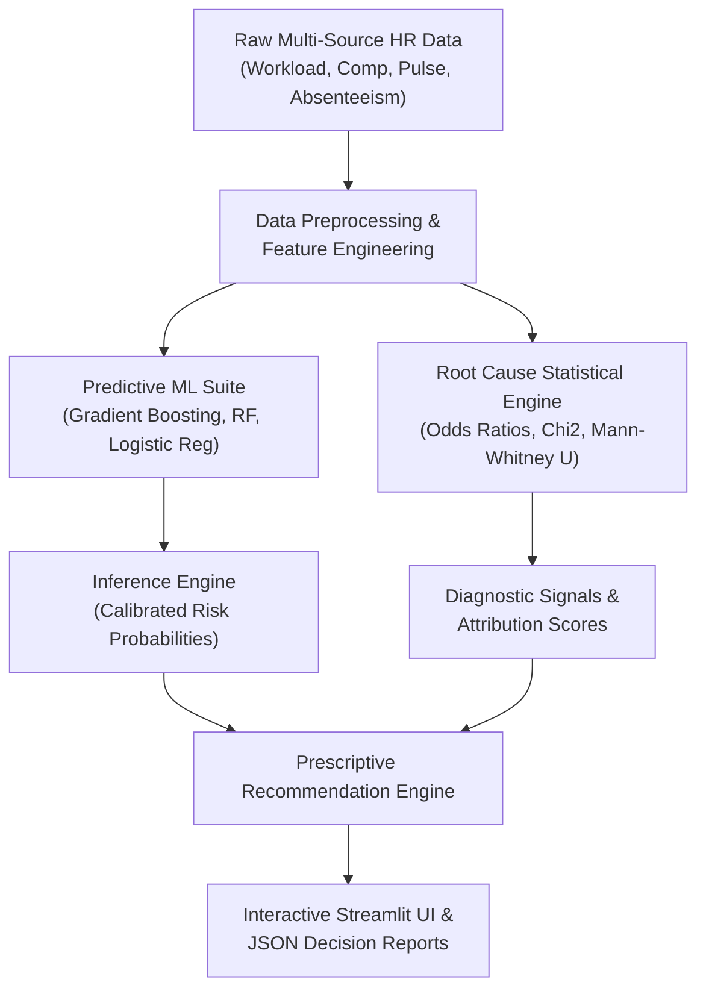

# Technical Deep Dive & Architecture

This document outlines the theoretical foundations, statistical methodologies, machine learning architecture, and domain modeling implemented in **Employee Attrition Root-Cause Intelligence**.

---

## 1. High-Level Architecture Overview

---

## 2. Statistical Root-Cause Methodology

Unlike pure black-box classification, HR decision-makers require **causal attribution and statistical rigor** to justify interventions before spending organizational capital.

### A. Odds Ratios (OR) and Relative Risk
For binary exposures (e.g., $E = 1$ if monthly overtime $>25$ hours, $0$ otherwise) and attrition status $Y \in \{0, 1\}$:

$$\text{Odds Ratio} = \frac{a \cdot d}{b \cdot c}$$

Where:
- $a = \text{Exposed \& Left}$
- $b = \text{Exposed \& Retained}$
- $c = \text{Unexposed \& Left}$
- $d = \text{Unexposed \& Retained}$

Standard Error of the log Odds Ratio:
$$\text{SE}(\ln \text{OR}) = \sqrt{\frac{1}{a} + \frac{1}{b} + \frac{1}{c} + \frac{1}{d}}$$

95% Confidence Intervals are calculated as:
$$\text{CI}_{95\%} = \exp\left(\ln \text{OR} \pm 1.96 \cdot \text{SE}(\ln \text{OR})\right)$$

An $\text{OR} > 1.0$ with lower CI boundary $> 1.0$ confirms that exposure significantly amplifies turnover odds.

### B. Two-Sample Statistical Tests (Continuous Drivers)
To compare continuous indicators (e.g., Compa-Ratio, Sick Leave Days, Hours Worked):
1. **Welch's Two-Sample T-Test:** Accommodates unequal variances between departed and retained populations:
   $$t = \frac{\bar{X}_1 - \bar{X}_2}{\sqrt{\frac{s_1^2}{n_1} + \frac{s_2^2}{n_2}}}$$
2. **Mann-Whitney U Test:** Non-parametric rank-sum test robust against skewed distributions (e.g., tenure, unexcused absences).
3. **Point-Biserial Correlation:** Measures linear association between continuous metrics and binary attrition.

### C. Chi-Square Test of Independence (Categorical Factors)
Tests whether categorical variables (Department, Contract Type, Education Level) operate independently of turnover:
$$\chi^2 = \sum \frac{(O_{ij} - E_{ij})^2}{E_{ij}}$$

---

## 3. Domain Feature Engineering

The preprocessor calculates domain-grounded interaction variables:

1. **Burnout Risk Score:**
   $$\text{Burnout Risk} = \left(\frac{\text{weekly\_hours}}{40.0}\right) \times (6 - \text{work\_life\_balance})$$
   Captures the compounding stress of long working hours combined with low self-reported balance.

2. **Compensation Stagnation Index:**
   $$\text{Comp Stagnation} = \max(0, 1.10 - \text{compa\_ratio}) \times \left(\frac{\text{last\_raise\_months\_ago}}{12}\right)$$
   Penalizes below-market pay exponentially as the time since the last salary increase increases.

3. **Career Velocity:**
   $$\text{Career Velocity} = \frac{\text{projects\_completed}}{\frac{\text{tenure\_months}}{12} + 0.5}$$
   Normalizes project contributions per year of tenure to isolate under-recognized high contributors.

---

## 4. Machine Learning Model Suite

Three models are trained and benchmarked using stratified cross-validation splits:
- **Gradient Boosting Classifier:** Captures complex non-linear feature interactions and high-order patterns.
- **Random Forest Classifier:** Provides balanced bagging ensemble with out-of-bag validation robustness.
- **L2-Regularized Logistic Regression:** Provides calibrated probabilistic risk assessments and interpretable directional coefficients.

The model producing the highest cross-validated F1/ROC-AUC is serialized and promoted to the inference service.

---

## 5. Recommendation Engine & ROI Economics

The recommendation engine translates diagnostic signals into cost-weighted interventions.

### Financial Return on Investment (ROI) Model
Replacing an employee incurs high tangible and intangible costs (recruiting fees, onboarding ramp-up, lost productivity), typically benchmarked at:
$$\text{Cost of Replacement} = \text{Monthly Salary} \times 6 \quad (\approx 50\% \text{ of Annual Base Salary})$$

Expected turnover prevention benefit:
$$\text{Expected Retention Benefit} = \text{Cost of Replacement} \times P(\text{Attrition}) \times \eta$$
Where $\eta = 0.50$ represents the conservative mitigation effectiveness of targeted intervention.

$$\text{Projected ROI} = \frac{\text{Expected Retention Benefit} - \text{Intervention Cost}}{\text{Intervention Cost}}$$

This ensures executive leadership can evaluate retention initiatives from a concrete cost-benefit perspective.

